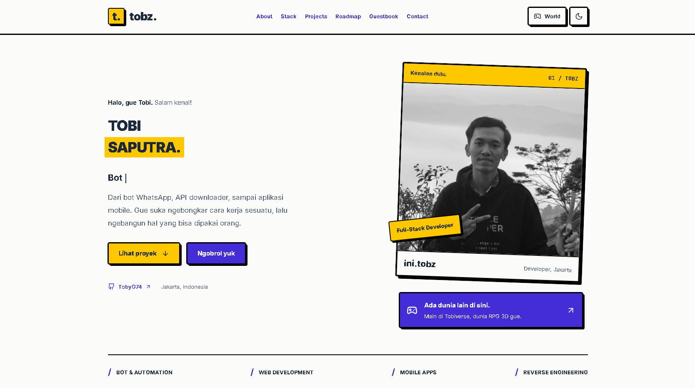

# Portfolio Tobi Saputra

Portfolio pribadi Tobi Saputra (TobyG74), berisi proyek, skill, perjalanan belajar, dan guestbook. Pengunjung juga bisa menjelajahi Tobiverse, dunia RPG 3D dengan NPC, misi, dan monster.

Website: [itztobz.me](https://itztobz.me). GitHub: [TobyG74](https://github.com/TobyG74).

## Preview



## Fitur

- Halaman portfolio dengan proyek, skill, roadmap 2016–2026, dan kontak.
- Tema terang dan gelap, serta layout untuk desktop dan mobile.
- Guestbook, penghitung pengunjung, dan leaderboard dengan penyimpanan Cloudflare KV.
- 3D World dengan pilihan karakter, NPC yang bisa diajak bicara, papan misi, senjata, level, dan monster yang muncul kembali.
- Kontrol keyboard dan joystick untuk layar sentuh.
- Siklus siang–malam berdasarkan jam lokal perangkat, serta lampu jalan yang menyala otomatis saat gelap.

Suasana world diperbarui setiap 10 detik. Fajar berlangsung sekitar pukul 06.00 dan senja sekitar pukul 18.00 dengan transisi bertahap. Ada 28 lampu jalan di desa dan sekitar bangunan di area luar; cahaya aktif diprioritaskan di dekat pemain sesuai kualitas render.

## Teknologi

Next.js 15 (App Router), React 19, Tailwind CSS, Three.js, React Three Fiber, Drei, Framer Motion, Lucide, dan Three Nebula. Penyimpanan memakai Cloudflare KV REST API; adapter OpenNext tersedia untuk Cloudflare Workers.

## Menjalankan project

Gunakan Node.js 22 atau lebih baru dan npm. Jalankan perintah berikut dari root project:

```bash
npm ci
cp .env.example .env.local
npm run dev
```

Buka [localhost:3000](http://localhost:3000). Kredensial KV boleh dikosongkan untuk mencoba project secara lokal. Jika kamu sudah memakai `.env`, langkah menyalin template bisa dilewati.

Server dev menyimpan output di `.next-dev`, sedangkan build produksi memakai `.next`, sehingga build tidak menimpa bundle server dev yang sedang berjalan.

Untuk menjalankan build produksi:

```bash
npm run build
npm start
```

## Kontrol 3D World

Buka `/world` melalui tombol **World** di navbar.

| Aksi | Desktop | Mobile |
|------|---------|--------|
| Bergerak | `W`, `A`, `S`, `D` atau tombol panah | Joystick |
| Menyerang | `Space` | Tombol **SERANG** |
| Bicara, membuka papan misi, atau masuk portal | `E` saat berada dekat objek | Tombol **TALK** |

Kualitas render menyesuaikan perangkat. Untuk memilihnya secara manual, buka `/world?quality=low`, `/world?quality=medium`, atau `/world?quality=high`.

## Mengubah konten

| File | Konten |
|------|--------|
| [`lib/content.js`](./lib/content.js) | Profil, sosial, dan roadmap |
| [`public/data/projects.json`](./public/data/projects.json) | Daftar proyek dan gambar |
| [`public/data/skills.json`](./public/data/skills.json) | Kategori skill |
| [`lib/config.js`](./lib/config.js) | Ukuran world, kontrol, kualitas render, dan tanggal festival |
| [`lib/npcs.js`](./lib/npcs.js) | NPC, dialog, dan penempatan bangunan |
| [`lib/game.js`](./lib/game.js) | Level, senjata, dan monster |
| [`lib/daylight.js`](./lib/daylight.js) | Perhitungan siklus siang–malam |

## Struktur

```text
app/                     Halaman utama, guestbook, world, dan API
components/              Komponen portfolio dan 3D World
lib/                     Konten, konfigurasi, logika game, dan penyimpanan KV
public/data/             Data proyek dan skill
public/images/           Gambar profil dan proyek
public/models/           Model dan tekstur yang digunakan world
scripts/check-*.mjs       Pemeriksaan konfigurasi, aset, dan logika game
preview.png              Screenshot untuk README
```

## Environment

Isi `.env.local` atau `.env` dengan nilai berikut untuk mengaktifkan penyimpanan KV:

| Variabel | Fungsi |
|----------|--------|
| `CLOUDFLARE_ACCOUNT_ID` | ID akun Cloudflare |
| `CLOUDFLARE_KV_NAMESPACE_ID` | ID namespace KV |
| `CLOUDFLARE_API_TOKEN` | Token dengan izin `Workers KV Storage: Edit` |
| `VISITOR_COUNTER_KEY` | Nama key counter; default `site_visitors` |

Tanpa kredensial KV, guestbook, penghitung pengunjung, dan leaderboard memakai penyimpanan dalam memori yang akan hilang ketika proses dimulai ulang.

Next.js membaca `.env*` saat development dan build. Untuk preview lokal Cloudflare Workers, salin `.dev.vars.example` ke `.dev.vars`. Wrangler juga mendukung `.env`, tetapi ketika `.dev.vars` tersedia, variabel lokal Worker dimuat dari `.dev.vars`. Perubahan isi kedua file tidak otomatis tersinkronisasi.

File environment lokal, `node_modules`, cache, dan output build sudah masuk `.gitignore`. Hanya template `.env.example` dan `.dev.vars.example` yang disertakan dalam repository. Simpan `package-lock.json` agar versi dependency konsisten saat `npm ci`.

## Pemeriksaan

Jalankan dari root project:

```bash
npm run lint
node scripts/check-next-config.mjs
node scripts/check-assets.mjs
node scripts/check-config.mjs
node scripts/check-daylight.mjs
node scripts/check-game.mjs
node scripts/check-collision.mjs
node scripts/check-festival.mjs
node scripts/check-rig.mjs
npm run build
```

## Deploy

Untuk hosting Node, gunakan `npm run build` dan `npm start`, lalu pasang environment di hosting tersebut. Repository ini memakai route API, sehingga memerlukan hosting yang menjalankan Next.js.

Konfigurasi Cloudflare Workers tersedia di [`wrangler.jsonc`](./wrangler.jsonc) dan [`open-next.config.ts`](./open-next.config.ts). Wrangler memakai entry `.open-next/worker.js` dan assets `.open-next/assets` yang dihasilkan build OpenNext, beserta binding untuk assets, optimasi gambar, dan akses Worker ke dirinya sendiri. Konfigurasi ini mengikuti [panduan OpenNext](https://opennext.js.org/cloudflare/get-started).

```bash
npx wrangler login
npm run preview
```

Untuk deploy ke Cloudflare:

```bash
npm run deploy
```

Script `preview` dan `deploy` menjalankan build OpenNext terlebih dahulu. `npm run build` hanya menghasilkan build Next.js di `.next`, sehingga belum cukup untuk menyiapkan output Worker. Jika mengganti nama Worker, ubah juga nilai `services[].service` agar sama dengan `name`.

Jalankan satu proses build, preview, atau deploy pada satu waktu. Proses yang berjalan bersamaan menulis ke folder `.next` dan `.open-next` yang sama dan bisa menghasilkan bundle rusak atau ekspor environment duplikat. Jika ini terjadi, tunggu semua proses selesai, lalu jalankan ulang `npm run cf:build`.

Pasang kredensial KV sebagai secret Workers sebelum deploy. Jangan menulis token asli di file konfigurasi yang akan diunggah ke GitHub.

Project pribadi Tobi Saputra.
